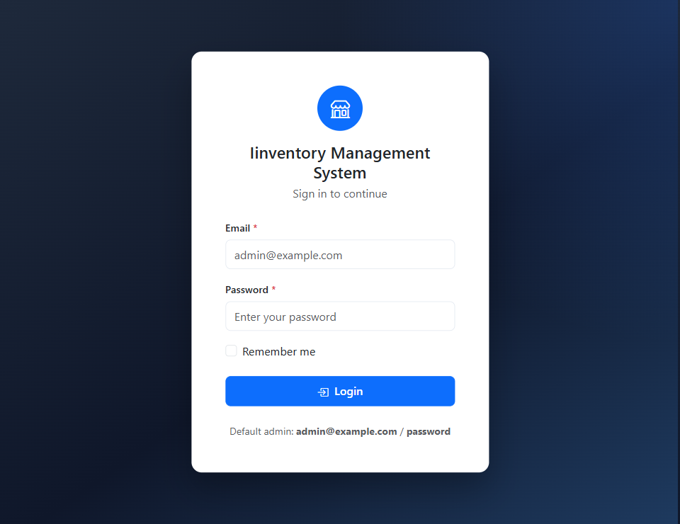
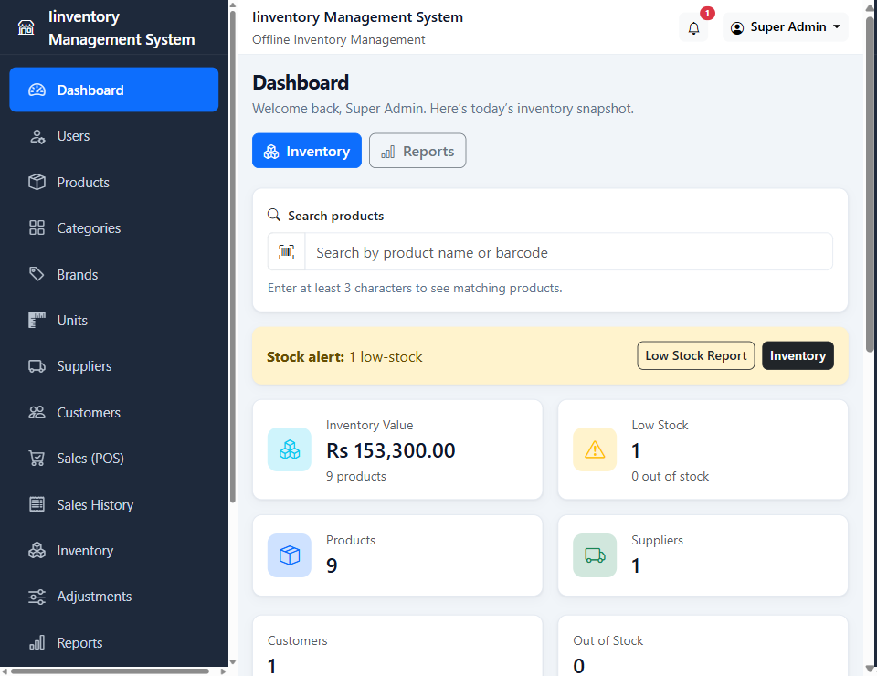
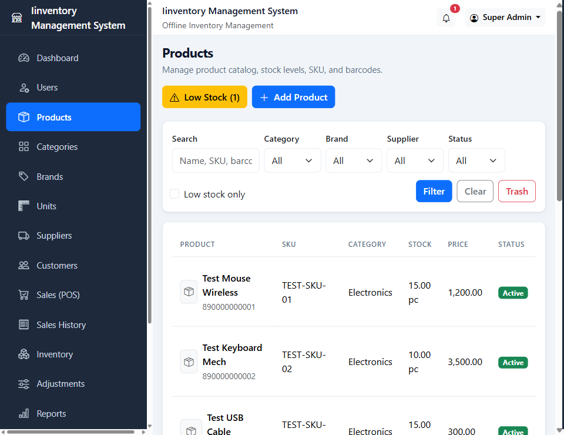
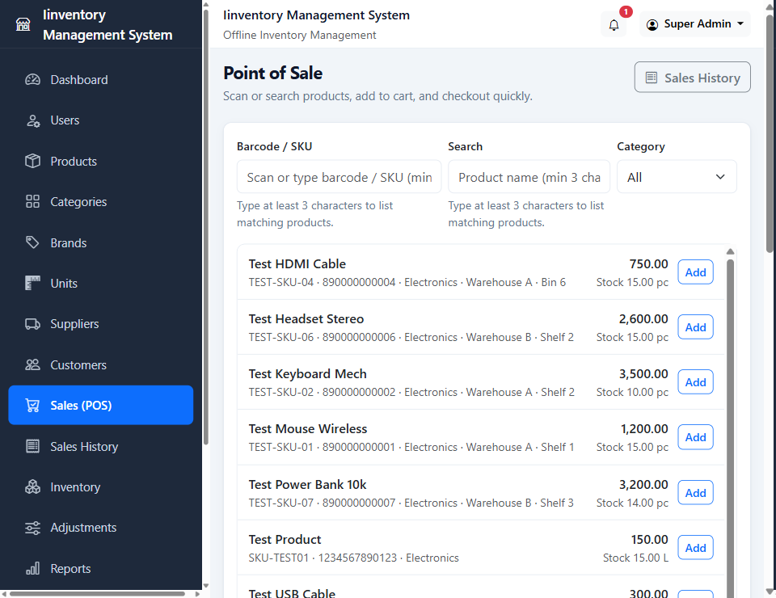
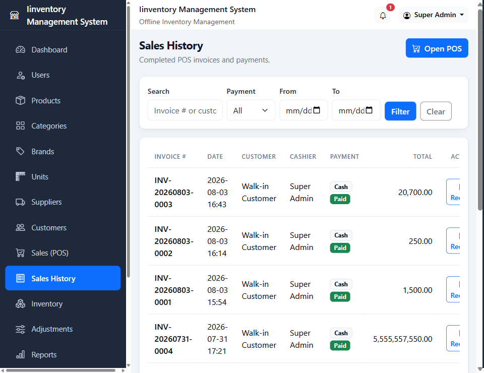
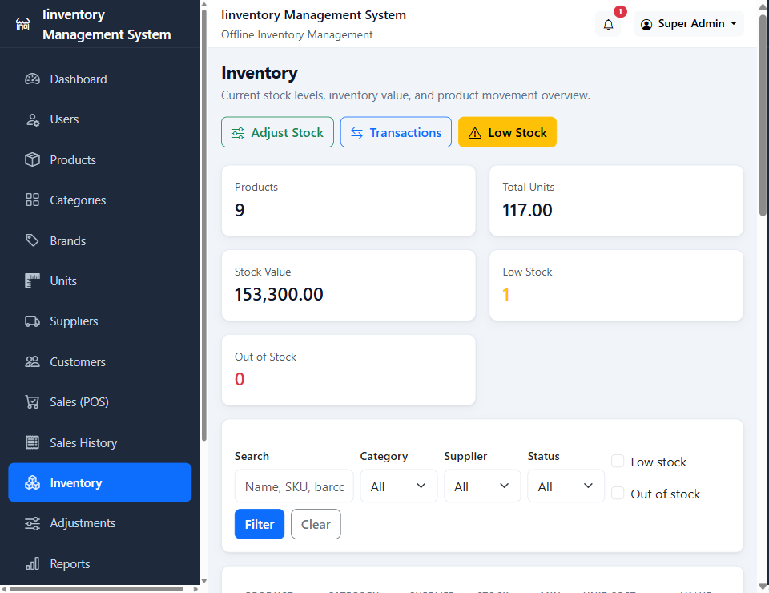
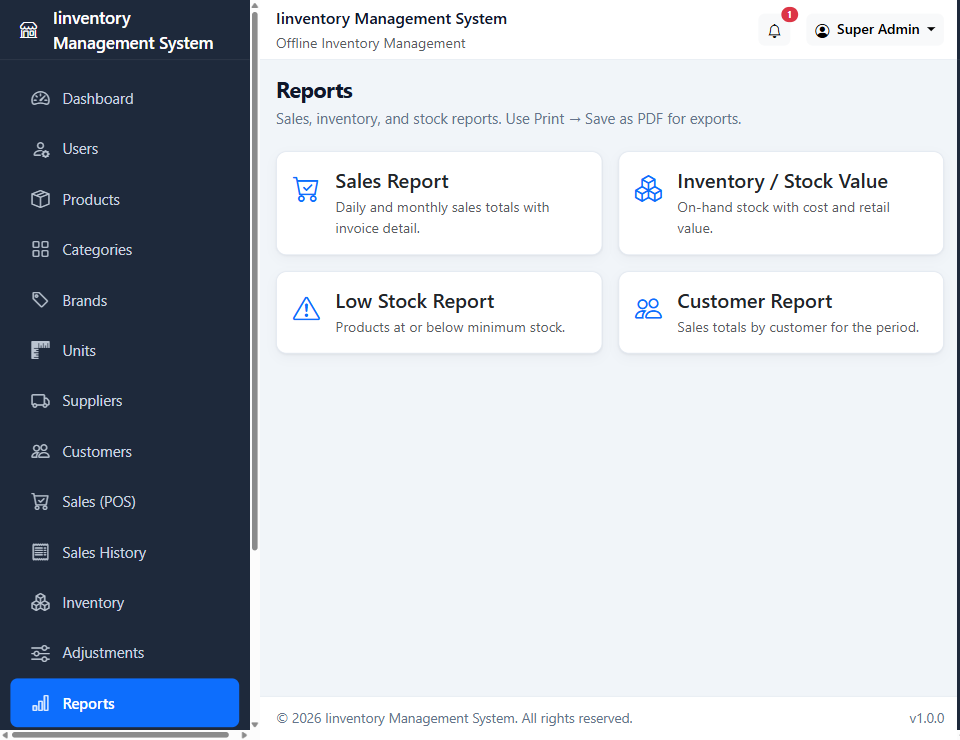
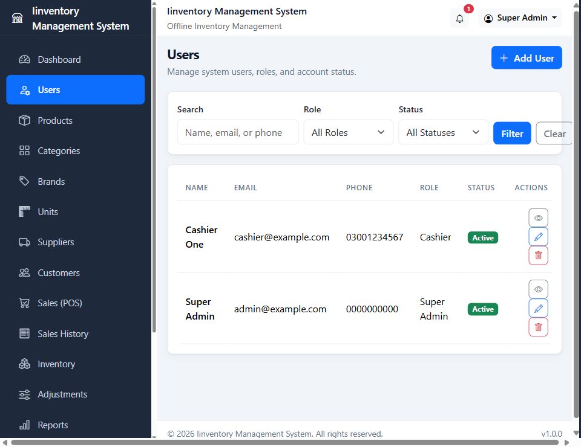

# Inventory Management System

An offline point-of-sale and inventory system for a retail shop. Staff sign in, sell from a cart, and stock updates with the sale. Built with Laravel and Bootstrap, with separate roles for admins, managers, inventory staff, and cashiers.

## Features

- Sign-in with role-based access control
- Super Admin and Admin have full control
- Manager, Inventory Manager, and Cashier see only the modules their role allows
- Product catalog with categories, brands, units, suppliers, SKU, and barcode
- Point of sale: search or scan, add to cart, take payment, print a receipt
- Sales history
- Inventory levels, stock value, low-stock alerts, and stock adjustments
- Customers and suppliers
- Sales, inventory, low-stock, and customer reports
- Shop settings, database backup and restore, and audit logs
- Responsive Bootstrap interface

## How a sale works

1. A cashier signs in and opens **Sales (POS)**.
2. They find a product by name, SKU, or barcode and add it to the cart.
3. They choose the customer, discount, tax, and payment method, then check out.
4. The invoice is saved and the product’s on-hand stock goes down.
5. The receipt is available from **Sales History**.
6. **Inventory** and **Reports** show the new stock and the day’s sales.
7. **Audit Logs** record who changed what.

## Tech Stack

- Backend: Laravel 13 (PHP 8.3)
- Frontend: Blade, Bootstrap 5, Bootstrap Icons
- Database: SQLite
- Authentication: Laravel session auth with role and permission checks

## Screenshots

### Login

### Dashboard

### Products

### Point of Sale

### Sales History

### Inventory

### Reports

### Users and roles

## Roles

| Role | What they can do |
| --- | --- |
| Super Admin | Everything, including users, settings, backups, and audit logs |
| Admin | Everything, including users, settings, backups, and audit logs |
| Manager | Catalog, stock, sales, customers, and reports |
| Inventory Manager | Catalog, stock, suppliers, and reports. No sales |
| Cashier | Dashboard, customers, and the point of sale |

## Installation

1. Clone the repository
2. Run `composer install`
3. Copy `.env.example` to `.env`
4. Run `php artisan key:generate`
5. Create the database file: `type nul > database\database.sqlite` (Windows) or `touch database/database.sqlite`
6. Run `php artisan migrate --seed`
7. Run `npm install`
8. Run `npm run build`
9. Start the server: `php artisan serve`
10. Open `http://127.0.0.1:8000`

### Default login

- Email: `admin@example.com`
- Password: `password`

## Author

[zarak-ahmad](https://github.com/zarak-ahmad)  
Full-Stack Developer (Laravel + MERN)
